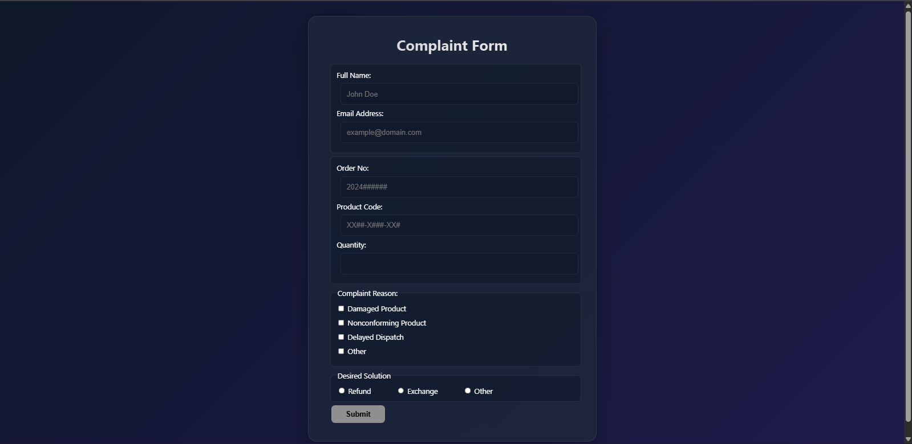

# Custom Customer Complaint Validation Interface

A premium, client-side validation layout deck engineered using HTML5 semantic elements, CSS3 variables, and vanilla JavaScript. This layout uses the modern web Constraint Validation API alongside custom validation scripts to process client inputs securely.

## Live Demo

[View Live Application Deployment Hosted via GitHub Pages](https://github.io)

## Features Developed

- **Real-Time Boundary Changes:** Form elements adapt dynamically using change listeners that paint borders green (valid) or red (invalid).
- **Custom Dialog Submodule Integration:** Replaced basic alert loops with a fully accessible modal dialog card window overlay deck.
- **Glassmorphism Theme Canvas:** Form design centered using linear color vectors, custom blur metrics, and responsive viewport sizing hooks.

## Lab Structural Validation Metrics

- Fully compliant with freeCodeCamp test specifications.
- Restricts numeric text formats to absolute positive whole integers using script evaluators.
- Controls optional character limits dynamically based on checkbox toggles.

## Credits

This project is part of the [freeCodeCamp](https://www.freecodecamp.org/) JavaScript Lab Project of the course section: Form Validation. I added the custom modal dialog message box for validation result and form style.
